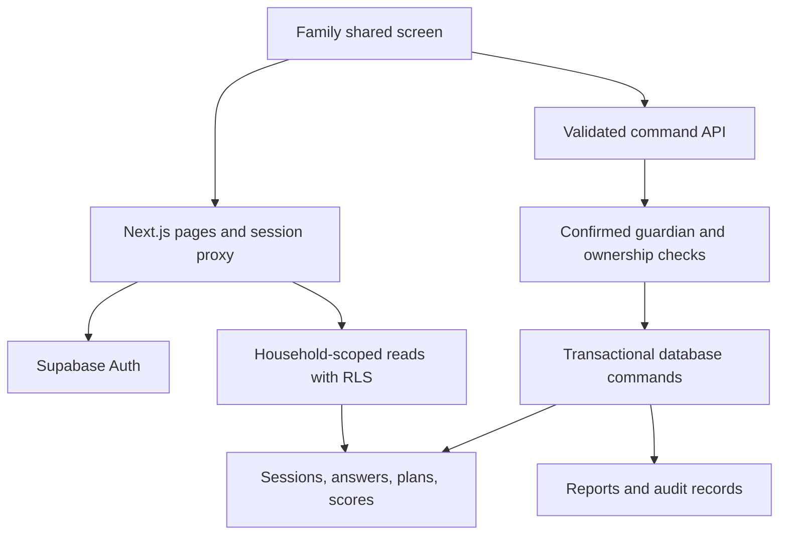

# QuiZone pilot architecture

## Boundaries

All logged-in accounts in this pilot are guardians; children have profiles inside a household and no independent tokens. A shared guardian screen is the supported play surface. A session code is an identifier, not an authorization credential or a cross-household invitation.

The server validates the Auth user with `getUser`; it never authorizes from `getSession` or editable user metadata. The API separately checks household/session ownership before calling the database. Reads use explicit ownership predicates with RLS as a second check. The proxy refreshes session cookies and marks refreshed responses private/no-store.

Published challenge versions and their steps cannot be changed in place. Correct answers live in a private schema without client table grants. Gameplay uses normalized session, participant, answer, score, and blueprint tables. The private command function locks the session row before validating the next step and applying a score, preventing replay and concurrent advancement from double-awarding progression.

SolveZone allocations and BuildZone feature costs are scored in the database. UI totals are convenience estimates; they never determine saved scores. Debate choices use fixed stages. WorldZone currently stores household-private country stamps and has no global submission endpoint.

Q exposes only a hint action. It returns reviewed, prewritten content and records provider, model, prompt/rubric version, session, output, and timestamp. No language-model API call is made. Live-model facilitation requires a separately configured provider, bounded prompts/output, safety evaluations, cost controls, and hosted verification.

## Limitations

The pilot uses five-second polling rather than a realtime broadcast subsystem. Guardian account confirmation and the live HTTP Auth/REST integration require a hosted Supabase project. PGlite verifies PostgreSQL behavior with identity stubs; it does not emulate the full Supabase platform. No public media bucket, direct child messaging, or cross-household data-sharing feature exists.
