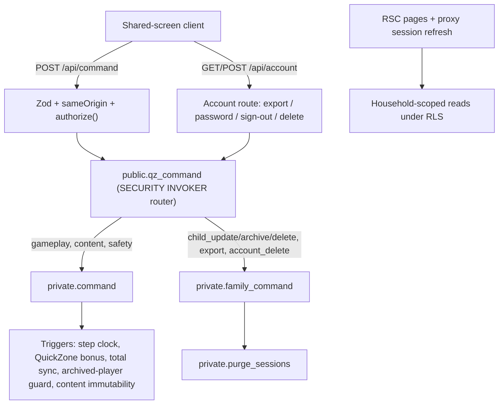

# QuiZone architecture (delta over `ARCHITECTURE.md`)

`docs/ARCHITECTURE.md` remains accurate for the pilot core. This file records what changed and the rules future batches must keep.

## Invariants (unchanged, now enforced in more places)

1. **One mutation boundary.** Clients have no INSERT/UPDATE/DELETE grants. Every write is `public.qz_command` → a `SECURITY DEFINER` function with `search_path=''`, which re-derives identity from `auth.uid()` and requires `email_confirmed_at`.
2. **Two independent authorization layers.** `lib/authorize.ts` checks household/session/child ownership via RLS-scoped reads before the RPC; the SQL function checks again. RLS on reads is the third layer.
3. **Server-authoritative scoring.** Base points in `private.command`; QuickZone bonus in a `BEFORE INSERT` trigger using the server clock (`game_sessions.step_started_at`); an `AFTER INSERT` trigger keeps `total_score = Σ player_answers.points`. No client field influences points (forged `points` is rejected by Zod; bonus/elapsed columns have no client grant).
4. **Additive migrations.** New behavior is added as new functions/triggers and a router swap — `private.command` from the first migration was not edited. Keep doing this until a deliberate consolidation migration.

## New components

| Area       | Files                                                                                                                                            |
| ---------- | ------------------------------------------------------------------------------------------------------------------------------------------------ |
| Migrations | `20261101120000_family_controls.sql`, `20261101130000_quickzone_scoring.sql`                                                                     |
| API        | `app/api/account/route.ts`                                                                                                                       |
| UI         | `components/explorer-card.tsx`, `components/account-privacy.tsx`; Family/Challenges/Home/Game updated                                            |
| Tests      | `tests/support/db.ts` (all migrations, ordered), `tests/family-controls.test.ts`, `tests/quickzone-scoring.test.ts`, `e2e/family-journey.e2e.ts` |
| CI         | `.github/workflows/e2e.yml` (local Supabase stack + Playwright + axe + plpgsql_check)                                                            |

## Data-lifecycle rules

- **Archive** (`archived_at`) keeps history; a trigger on `session_players` blocks archived explorers from any new session. Archived profiles still count toward the 8-profile cap.
- **Explorer delete** is refused while the explorer has an open session or an unresolved safety report; it purges sessions they played alone and strips their rows from shared sessions.
- **Account delete** purges the household graph, the guardian's reports and audit rows, then `auth.users`. Staff accounts are refused (their actions are other households' audit history). A non-identifying row goes to `private.account_deletions`.

## Evolution path (next architectural step)

Multi-device play and family invitations need a `household_members(household_id, user_id, role)` table and replacing `private.owns()`'s `guardian_id = auth.uid()` with a role-aware check (`guardian` manages; `member` plays/views). Do this as one migration that rewrites the helper functions, keeps `households.guardian_id` as the owner of record, and extends the RLS test matrix before adding any UI. Supabase Realtime (broadcast of state-change events from the command function) can then replace 5-second polling.
