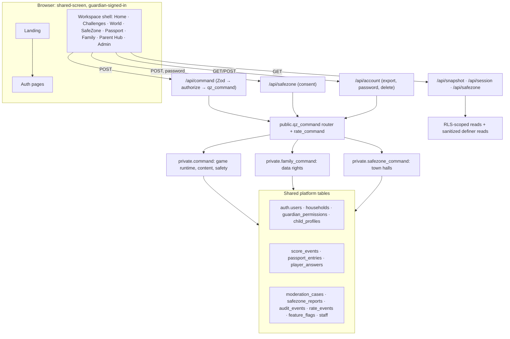

# QuiZone AI — master architecture

**One application, one identity, one learning journey.** All zones run in one Next.js App Router app on one Supabase Postgres schema. There are no per-zone apps, accounts, consent systems, or databases. Details per area: `QUIZONE_ARCHITECTURE.md` (command and data-lifecycle rules), `SAFEZONE_SPEC.md`.

## Shared services (built once, used by every zone)

| Service                 | Implementation                                                                                                                              | Zones using it                                             |
| ----------------------- | ------------------------------------------------------------------------------------------------------------------------------------------- | ---------------------------------------------------------- |
| Identity                | Supabase Auth guardian accounts; `getUser`/`getClaims` server-side only                                                                     | All                                                        |
| Family & child profiles | `households`, `child_profiles` (archive/delete)                                                                                             | All                                                        |
| Consent & permissions   | Household consent at creation; `guardian_permissions` (World, Q, SafeZone, session limit); SafeZone per-session consent with fresh password | All; SafeZone adds its own gate                            |
| Authorization           | API ownership checks + definer command functions + RLS                                                                                      | All                                                        |
| Game runtime & scoring  | `game_sessions`, server-side step clock, triggers                                                                                           | QuickZone, SolveZone, BuildZone, DebateZone, WorldZone     |
| Progress                | `score_events` (XP, skill), `passport_entries`                                                                                              | Game zones; SafeZone shows participation in the Parent Hub |
| Moderation & safety     | `moderation_cases` (game), `safezone_reports` + events (town halls), staff roles                                                            | Game zones, SafeZone                                       |
| Audit                   | `audit_events` written by every command                                                                                                     | All                                                        |
| Rate limiting           | `private.rate_limit` (reauth, export, command)                                                                                              | All                                                        |
| Feature flags           | `private.feature_flags` (operator SQL)                                                                                                      | SafeZone (more to follow)                                  |
| AI                      | Curated hints with an `ai_evaluations` log; no live provider                                                                                | Q (hints)                                                  |
| Data rights             | Export v2 (all zones incl. SafeZone), cascading deletion                                                                                    | All                                                        |

## Architectural rules (enforced by review and tests)

1. Additive migrations only, routed through `public.qz_command`. Clients never get table writes.
2. One identity and consent model. New zones extend `guardian_permissions` and `child_profiles`; they never create parallel ones.
3. Cross-household data leaves the database only through sanitized definer reads (handles, aggregates), never raw rows.
4. Every new zone ships behind a feature flag until it has DB tests, browser E2E, and a `FAMILY.md` checklist.
5. Rollback script for every post-pilot migration (`supabase/rollback/`).

## Decisions that shape the next architecture step (owner input needed)

| Topic                           | Current                                                              | Options                                                                                                                                                 |
| ------------------------------- | -------------------------------------------------------------------- | ------------------------------------------------------------------------------------------------------------------------------------------------------- |
| Child sign-in / child dashboard | Children have no credentials; they act through the guardian's device | (a) keep the shared screen (PRD); (b) household-scoped child PIN profiles under the guardian session, with no independent account (fits `FAMILY.md` §1) |
| Family members & multi-device   | Guardian only                                                        | `household_members` roles + invite codes (planned QZ-05)                                                                                                |
| Educator Hub                    | Not built (PRD: post-MVP)                                            | A classroom model needs schools, educators, and consent-by-proxy design                                                                                 |
| AI companion                    | Curated hints only                                                   | Provider choice + server-only key + bounded prompts + moderation + budgets                                                                              |
